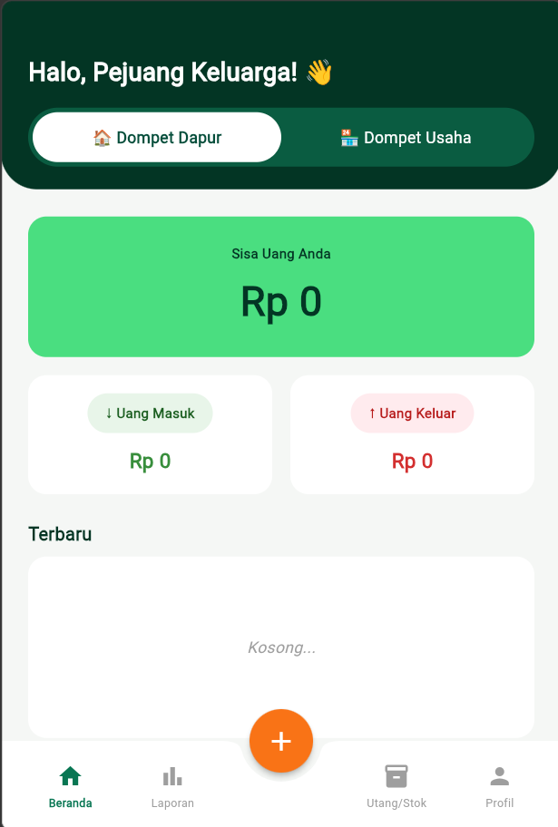
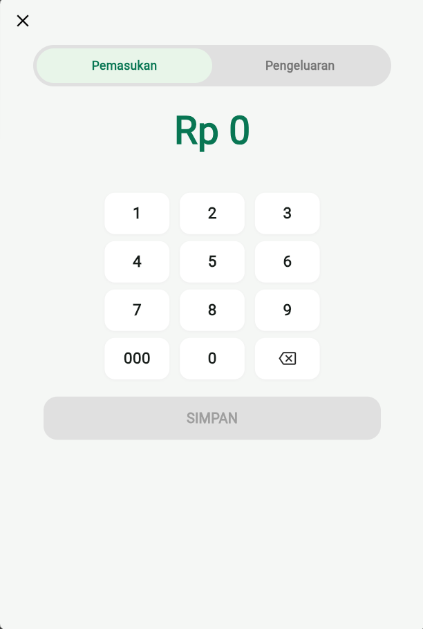
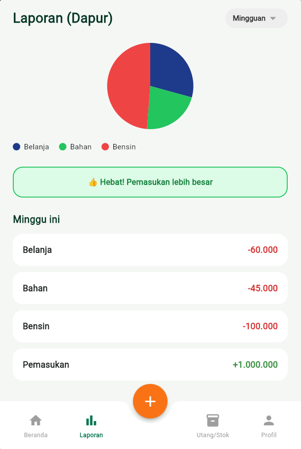
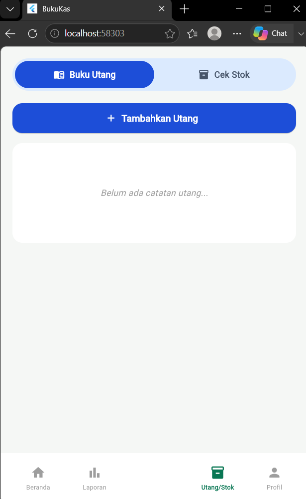
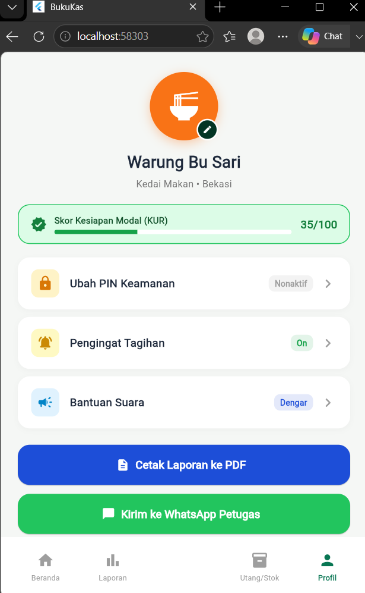

# BukuKas — Aplikasi Pencatatan Keuangan Keluarga & Usaha

**BukuKas** adalah aplikasi mobile dan web berbasis **Flutter (Material Design 3)** yang dirancang untuk membantu pelaku UMKM, pemilik warung, dan rumah tangga memisahkan pencatatan keuangan pribadi dan usaha secara praktis, responsif, dan terintegrasi.

Proyek ini dikembangkan untuk memenuhi Ujian Tengah Semester (UTS) mata kuliah **Pengembangan Aplikasi Mobile Front-End**.

---

## Anggota Kelompok (MoneyLaundry)

| No | Nama | NIM |
| :---: | :--- | :--- |
| 1 | Ryu Kierando | 241112002 |
| 2 | Nixon Culver | 241111437 |
| 3 | Kendrick Lazuardy | 241112234 |

---

## Fitur Utama

1. **Beranda & Pemisahan Dua Dompet (`main.dart`, `saldo_carousel.dart`)**
   * Pemisahan saldo dan arus kas antara **Dompet Dapur** (keuangan rumah tangga) dan **Dompet Usaha** (keuangan bisnis).
   * Kartu saldo interaktif `SaldoCarousel` yang dapat digeser (*swipe*) ke kiri/kanan dengan deteksi defisit otomatis.
   * Ringkasan **Uang Masuk** dan **Uang Keluar** secara *real-time* beserta daftar transaksi **Terbaru** yang terfilter sesuai dompet aktif.

2. **Input Transaksi dengan Custom Numpad (`halaman_input.dart`)**
   * Pemilihan jenis transaksi **Pemasukan** atau **Pengeluaran**.
   * *Custom numeric keypad* (`000`, `0`, hapus) dengan pemformatan ribuan otomatis (`Rp`).
   * 8 pilihan kategori pengeluaran (*Bahan, Bensin, Modal, Gas, Gaji, Tagihan, Belanja, Servis*) dan dialog pemilihan dompet tujuan.

3. **Laporan & Visualisasi Pie Chart (`halaman_laporan.dart`)**
   * Grafik lingkaran (**Pie Chart**) kustom menggunakan `CustomPaint` dan `CustomPainter` tanpa *package* eksternal.
   * Indikator kesehatan keuangan otomatis, filter periode (*Harian, Mingguan, Bulanan*), dan riwayat transaksi per dompet.

4. **Manajemen Utang & Cek Stok (`halaman_utang_stok.dart`)**
   * **Buku Utang:** Mencatat piutang pelanggan, mengedit nama/nominal, menghapus catatan, dan mengubah status pembayaran (*Baru, Ditunggu, Lewat, Lunas*).
   * **Cek Stok:** Memantau kapasitas bahan baku (*Bahan, Bensin, Gas*) dengan indikator warna dinamis dan fitur **`+ Restok`** yang otomatis memotong saldo dompet terpilih serta mencatatnya sebagai pengeluaran.

5. **Profil Usaha & Ekspor Laporan (`halaman_profil.dart`)**
   * Kustomisasi profil usaha (nama, kategori/kota, ikon, dan warna tema).
   * Kalkulasi otomatis **Skor Kesiapan Modal (KUR)** skala `0–100` beserta daftar misi kelayakan.
   * Pengaturan **PIN Keamanan 4 digit**, **Pengingat Tagihan**, **Bantuan Suara**, pratinjau **Cetak Laporan ke PDF**, dan **Kirim ke WhatsApp Petugas** (otomatis salin ke *clipboard*).

6. **Tampilan Responsif (Mobile & Desktop/Web)**
   * Menggunakan `LayoutBuilder` dan `MediaQuery` sehingga antarmuka beradaptasi mulus di layar HP (*portrait*), tablet (*landscape*), maupun browser desktop.

---

## Struktur Proyek

```text
bukukas_app/
├── lib/
│   ├── main.dart                  # Kerangka utama, navigasi bawah, state global, & Beranda
│   ├── saldo_carousel.dart        # Komponen kartu saldo swipeable & indikator defisit
│   ├── halaman_input.dart         # Halaman input transaksi & custom numpad
│   ├── halaman_laporan.dart       # Halaman laporan & PieChartPainter
│   ├── halaman_utang_stok.dart    # Halaman manajemen Buku Utang & Cek Stok
│   └── halaman_profil.dart        # Halaman Profil Usaha, Skor KUR, & Ekspor Laporan
├── screenshots/
│   ├── beranda.png
│   ├── input.png
│   ├── laporan.png
│   ├── utang_stok.png
│   └── profil.png
├── pubspec.yaml
└── README.md
```

---

## Tangkapan Layar Aplikasi

| Beranda | Input Transaksi | Laporan |
| :---: | :---: | :---: |
|  |  |  |

| Utang & Stok | Profil & Ekspor |
| :---: | :---: |
|  |  |

---

## Cara Menjalankan Proyek

1. **Clone repositori ini:**
   ```bash
   git clone [https://github.com/ryukierando05/bukukas_app.git](https://github.com/ryukierando05/bukukas_app.git)
   cd bukukas_app
   ```
2. **Unduh dependensi Flutter:**
   ```bash
   flutter pub get
   ```
3. **Jalankan aplikasi:**
   ```bash
   flutter run
   ```