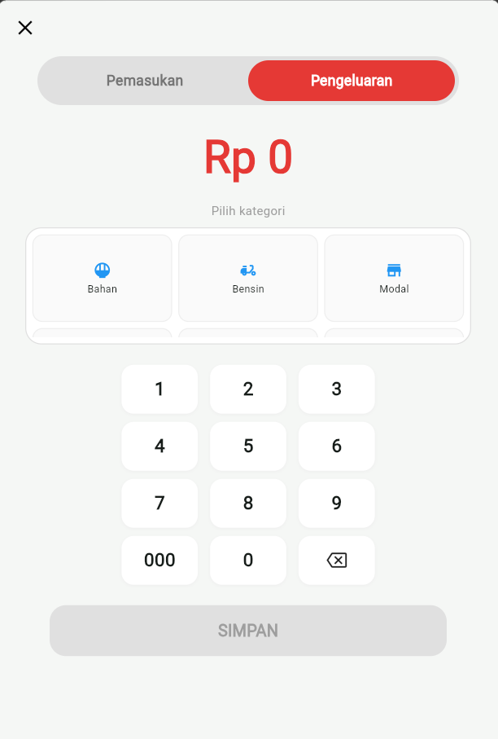

# BukuKas - Digitalisasi Catatan Keuangan

Aplikasi pencatatan keuangan sederhana berbasis Flutter untuk membantu pengolahan keuangan Dompet Dapur dan Dompet Usaha.

## Tampilan Aplikasi

### 1. Dashboard Utama (Beranda)

### 2. Input Transaksi (Pemasukan & Pengeluaran)

### 3. Laporan Visual (Pie Chart & Riwayat)

## Fitur Utama
- **Multi-Wallet**: Mendukung pemisahan akun Dompet Dapur dan Dompet Usaha.
- **Input Transaksi**: Numpad kustom untuk memasukkan nominal serta kategori pengeluaran.
- **Laporan Visual**: Pie chart dinamis berdasarkan persentase kategori transaksi.
- **Indikator Kesehatan**: Peringatan otomatis jika pengeluaran melebihi pemasukan.